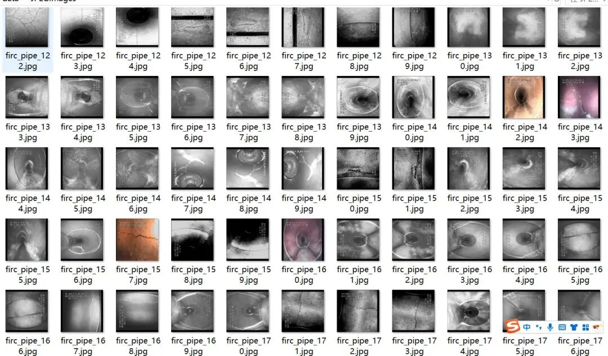
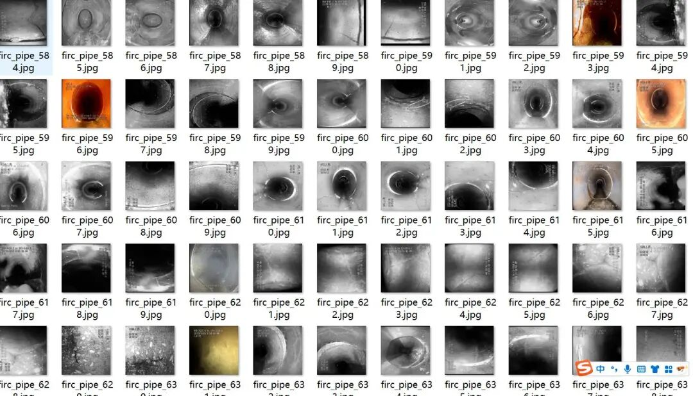
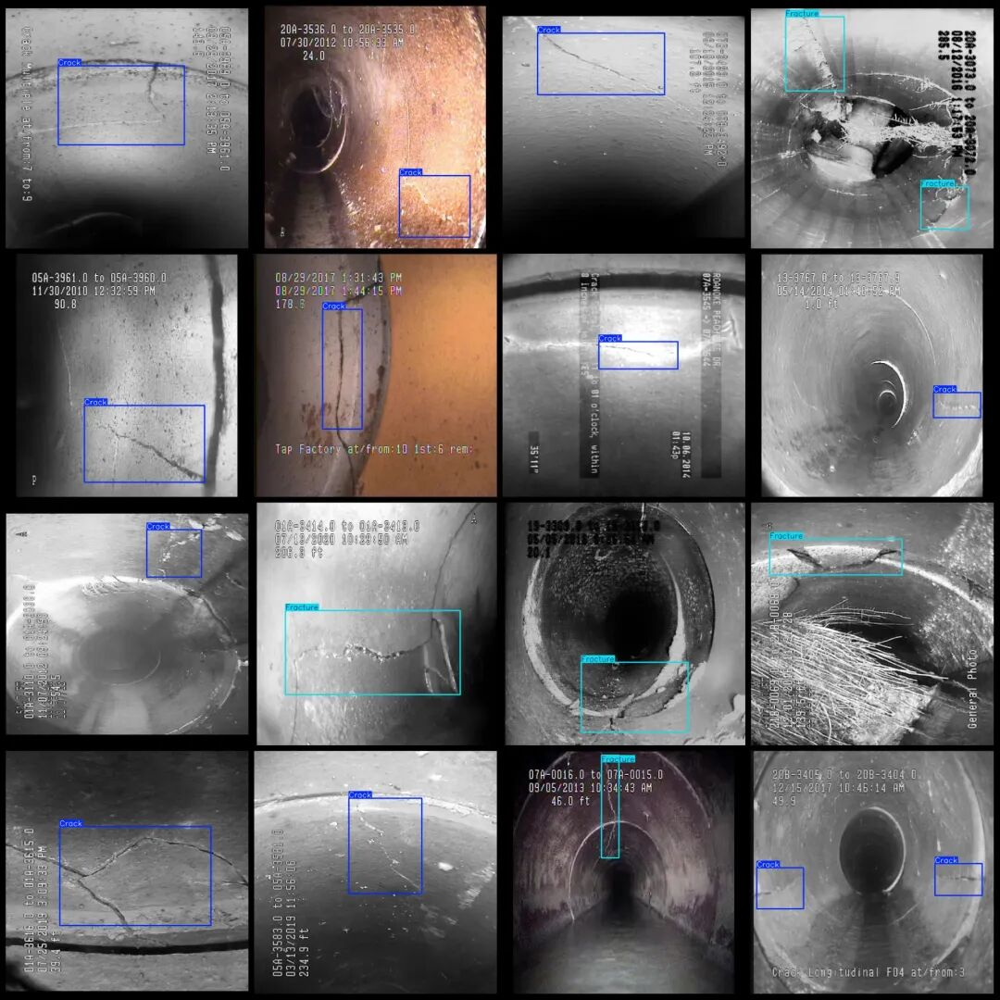

# CCTV Inspection Data Set for Clogged Drainage - VOC+YOLO format with 2 categories, 2696 images.

Dataset format: Pascal VOC format + YOLO format (txt file without split path, only containing jpg images and corresponding VOC format xml files and yolo format txt files)

Number of images (number of jpg files): 2696

Number of annotations (number of xml files): 2696

Number of annotations (number of txt files): 2696

Labeling category count: 2

Label category names (Note that the order of categories in the YOLO format does not correspond to this, but is based on the classes.txt file in the labels folder): ["Crack", "Fracture"]

Number of boxes labeled in each category:

Crack (fragment) frame count = 2296

Fracture (fracture) frame count = 730

Total frame count: 3026

Image resolution: 640x640

Is the dataset enhanced? Yes, about 1400 are original images and the rest are enhanced.

Using labelImg:

Annotation rules: Draw a rectangle around the category.

Important Notice: No

Special : This dataset does not guarantee the accuracy of the trained models or weight files.

Image Preview:

Annotation example:

## Payment

Here is a pay link on Stripe ( https://buy.stripe.com/3cs8yP7sY87d0vu9AB ). Please contact me lonlonago@foxmail.com after funding $89, and I will send you a complete data files , thank you!

